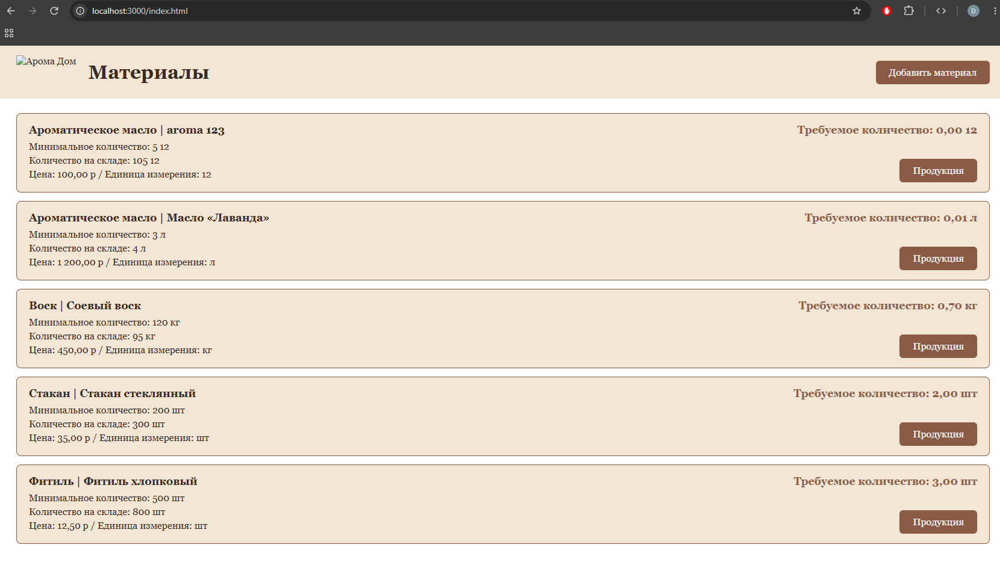
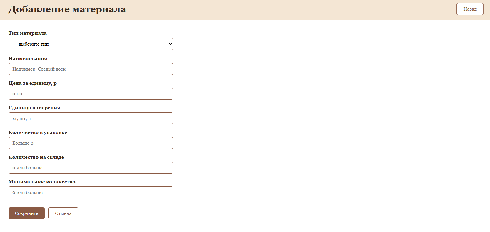
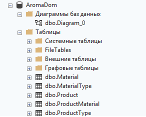
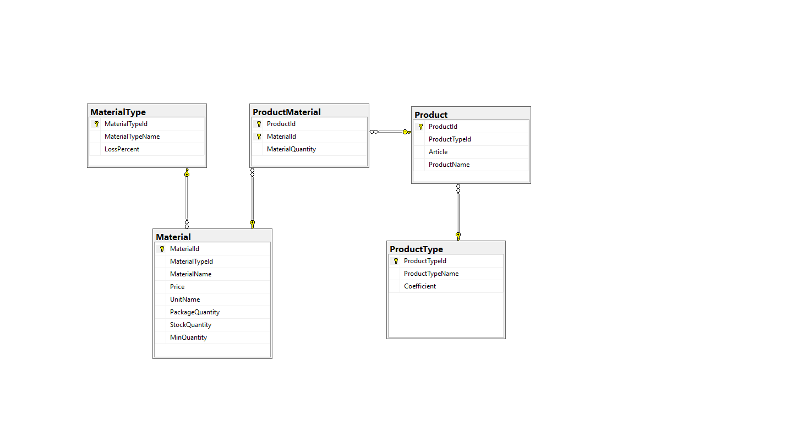

candle-materials/
├── src/
│   ├── config/
│   │   └── database.js
│   ├── routes/
│   │   ├── materials.js
│   │   └── products.js
│   ├── services/
│   │   └── calculations.js
│   └── app.js
├── public/
│   ├── index.html
│   ├── material-form.html
│   ├── products.html
│   ├── css/
│   │   └── style.css
│   └── js/
│       └── app.js
├── database/
│   └── script.sql
├── package.json
└── README.md


**(запустить тесты):

```bash
node --test


```

**(запустить проект):

```bash
npm start


```


подробнее о тестах в браузере
(Открыть http://localhost:3000/api/products/calculate?productTypeId=1&materialTypeId=1&quantity=100&param1=0.5&param2=0.4. Должно прийти {"result":408}.
Подставить productTypeId=99. Должно прийти {"result":-1}. То же при отрицательных или пустых параметрах.
На главной нажми «Продукция» на карточке воска. Должны открыться 3 свечи с расходом 0,2, 0,2 и 0,3 кг. Заголовок страницы и вкладки должен содержать название материала.
Кликнуть по самой карточке. Должна открыться форма редактирования, а не продукция.
В форме редактирования проверь кнопку «Продукция материала» и кнопку «Назад».)














